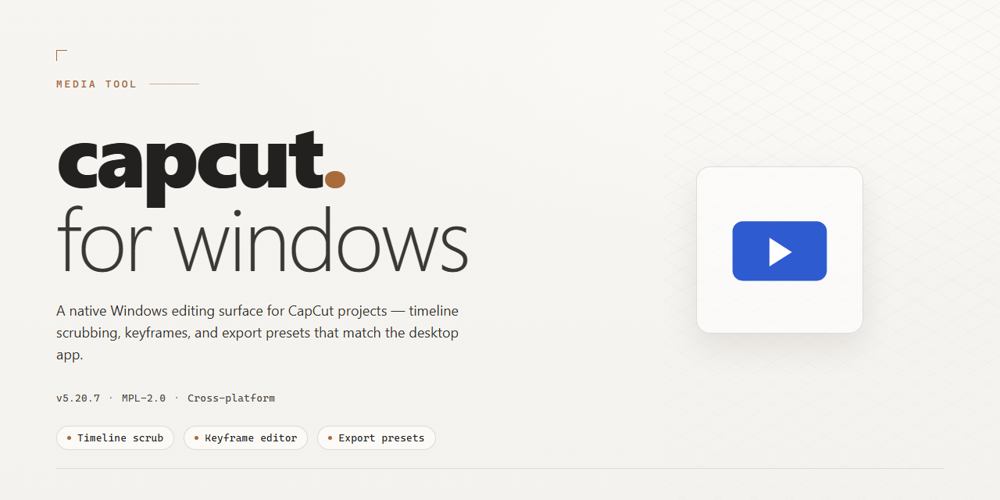

# 🎬 CapCut for Windows: Pro Video Editing, Screen Recording & VFX Workflow — Video Tool

### 🚀 PowerShell Quick Install

   

---

This build brings the full editing suite to your desktop, with every professional video, screen recording, and VFX tool installed and ready to launch the moment setup finishes. Think of it as a complete post-production station: arrange your timeline, layer effects, and capture your screen without ever leaving the app. The workflow stays fast and visual, so you can move from raw footage to polished cut in a single session. Everything runs locally on Windows, keeping your projects and presets right where you work.

## ✅ Before You Start

- Windows 10 or Windows 11
- PowerShell 5.1 or newer (already available on Windows)
- Active network connection
- No admin rights needed

## Features

**Everything you need, already on the timeline.**

This isn't a stripped-down editor with a paywall hiding the good stuff. The installer arrives fully loaded — every professional tool unlocked and ready to cut the moment the progress bar finishes.

**Multi-track timeline that keeps up with your ideas.** Drag, slice, ripple, and roll with frame-accurate precision. Layer video, audio, overlays, and text without the timeline fighting back. Snapping that feels magnetic, not stubborn.

**Screen recording baked right in.** Capture your desktop, a single window, or a region with clean audio sync — no second app, no juggling exports between tools. Hit record, do your thing, and the footage lands directly in your media bin.

**VFX and transitions with actual personality.** Glitch, bloom, motion blur, particle overlays, and a transition library that doesn't look like everyone else's slideshow. Stack effects, keyframe the intensity, and dial in the exact look you're chasing.

**Color that behaves like a grading suite.** Lift, gamma, gain, curves, and scopes in a panel that stays out of your way. Match shots between takes, push a mood, or keep it neutral and clean.

**Audio tools that finish the job.** Ducking, EQ, fades, and noise reduction — enough to get a mix broadcast-ready without leaving the editor.

**Export presets that respect your workflow.** Straight to the platforms you actually publish on, plus custom bitrate, resolution, and codec control when you want to be specific. Hardware acceleration keeps renders moving.

**Runs local. Runs offline. Runs now.** No account gate, no cloud round-trip, no "upgrade to unlock." Install it, open it, and start cutting — the full toolkit is already there waiting.

## How it works

Start with a single timeline. Drop in footage, drag clips into order, trim edges, and layer tracks the way a storyboard stacks scenes. The installer arrives as a complete desktop build, so all the editing, screen recording, and VFX modules are already wired together — no piecemeal assembly, no missing panel, no hunting for a plugin before the first cut.

Screen capture and editing share the same canvas. Record a window, a region, or a full screen, and the capture lands directly on the timeline where it can be sliced, color-graded, and matched against the rest of the project. Visual effects sit in a side panel: apply transitions, keyframe motion, mask out distractions, and stack adjustment layers until the frame looks the way it should.

The workspace favors muscle memory. Keyboard shortcuts stay consistent across editing, recording, and effects panels, so switching between tasks never breaks the rhythm. Previews render as you work, and export settings are compact enough to preview the final file before committing to a full render.

Everything runs locally on Windows x64. The build is self-contained: assets, effects libraries, and project templates ship inside the installer, so the whole editing pipeline stays on the machine. No external dependencies to chase, no accounts to map, no cloud round-trips between capture and final cut.

For teams testing deployment, the installer is a single reproducible package. Run it once, and the same editing environment appears on every machine — matching panels, matching shortcuts, matching render behavior. That consistency is what makes the build useful for both solo editing sessions and staged rollout checks.

## Workflow

Open the editor and you land in a timeline-first canvas: media bin on the left, preview stage in the center, inspector on the right. The workflow is built around that single loop — import, cut, style, export — so you're never hunting through menus to move a project forward.

**1. Bring your footage in.** Drag clips straight onto the media bin or drop them directly into the timeline. Screen recordings, gameplay captures, phone video, and stills all land in the same bin, tagged and ready to sort. Multi-track layering is available from the first second — park your main cut on track one and leave the upper tracks for overlays, titles, and effects.

**2. Shape the cut.** Trim by dragging clip edges, ripple-delete to close gaps, and split at the playhead with a single keystroke. Use the magnetic timeline to keep adjacent clips locked together while you rearrange scenes. Mark in and out points to lift only the frames you need, then nudge them frame-by-frame for precise timing.

**3. Record and layer.** Screen recording runs alongside the edit — capture a window, a region, or the full display, with system audio and microphone on separate channels. Drop the capture straight onto a new track, then layer commentary, b-roll, or picture-in-picture on top.

**4. Style with VFX tools.** Apply transitions, filters, and motion effects from the effects panel, then fine-tune keyframes in the inspector. Speed ramps, masks, blend modes, and color adjustments all live in the same panel — scrub the playhead and watch the preview update live, so styling stays visual rather than guesswork.

**5. Mix the audio.** Detach audio from video, duck music under dialogue with volume keyframes, and add fades at clip boundaries. Waveforms render inline on the timeline so you can cut to the beat without leaving the canvas.

**6. Export and iterate.** Choose a preset for the destination — social, archive, or high-bitrate master — and render from the export panel. The project file stays intact, so revisions are a matter of reopening, adjusting a few clips, and re-rendering. Save versions as you go to keep alternate cuts side by side.

The whole loop is designed to keep your eyes on the preview: every tool opens in context, every change is visible immediately, and the timeline stays the single source of truth from first import to final render.

## FAQ

**Everything looks broken after a project gets big — where do I start?**
Zoom out before you zoom in. Duplicate the sequence, hide the heavy VFX layers, and play back the raw cut. Nine times out of ten the "crash" is a single noisy effect stack choking your timeline, not the tool itself. Strip back to the bones, confirm playback is smooth, then reintroduce your layers one at a time.

**My screen recording and my edit feel like they were made by two different people.**
That's a workflow gap, not a software one. Lock your capture resolution and frame rate to match your sequence settings *before* you hit record. Mismatched capture-to-timeline ratios are the silent killer of every smooth montage. Match them up and your footage lands on the timeline already color-consistent and crisp.

**How do I keep effects from eating my whole render queue?**
Think of VFX like seasoning, not the meal. Bake your transitions and color into render-friendly chunks, then stack the flashy particles and light leaks last — after you've locked picture. Your export won't just finish faster; it'll survive a re-edit without you having to rebuild half the look from scratch.

**Is there a "right" order to approach a fresh project?**
Rough cut first, always. Drag every asset in, slice away the dead air, and get the story breathing before you touch a single transition. Color, sound polish, and VFX are the icing — icing applied to a cake that's still in the oven melts into a mess. Assembly before artistry, every single time.

**Why does my timeline feel sluggish even with a powerful machine?**
Preview settings are doing you dirty. Drop your playback resolution a notch while you edit, and bump it back up only for the final review. Editing at full quality on every scrub is like running a marathon in dress shoes — technically possible, deeply inefficient.

**What's the smartest way to use this build across multiple projects and clients?**
Keep a personal "starter scene" with your go-to effects chain, screen-record frame, and export preset already dialed in. Clone it, rename it per project, and you'll never waste the first twenty minutes of a session rebuilding the same setup. Your future self — the one on a deadline — will thank you.

## License

This build is released under a permissive license designed for creators who move fast and cut faster. You are free to run, modify, and integrate the installer into your own video production pipeline — whether that's a solo editing desk, a small studio render farm, or a classroom full of timelines waiting to be trimmed. Think of the license as the timeline track beneath your workflow: it stays out of the way while everything else plays smoothly on top.

Attribution is appreciated but not a blocker. If this installer saves you a render cycle, a reinstall headache, or an afternoon of driver roulette, a simple credit back to the project keeps the creative loop alive. Redistribution of modified builds is welcome as long as the same freedoms travel with them — no locking down what someone else might remix, re-cut, or rebuild for their own screen.

Commercial use is permitted, including inside client-facing editing suites and screen-recording workflows. The only line drawn is warranty: this is a working installer shipped as-is, and the project makes no guarantees about frame-perfect behavior on every hardware configuration. Test it in your own environment first, back up your project files, and treat it the way you'd treat any new plugin before a deadline — preview, then commit.

For the full legal text and contribution terms, refer to the license file included with the project itself.